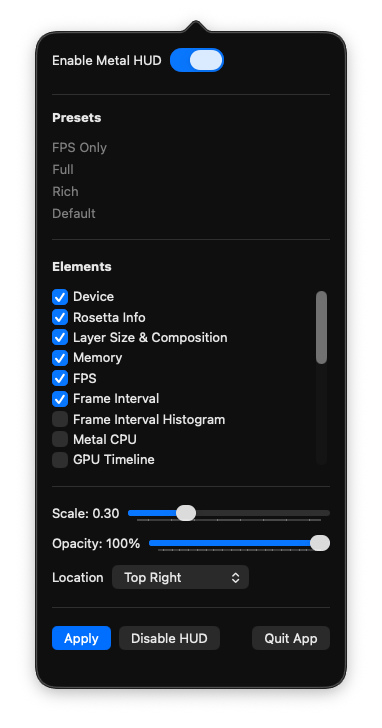

# MetalHUDmenu



A tiny macOS utility that configures Apple’s **Metal Performance HUD** system-wide. Toggle the HUD, pick elements (FPS, GPU time, memory, etc.), set opacity/scale, and place it on screen—without having to triple-click the HUD in-game.

---

## Features
- Enable/disable the Metal HUD
- Choose elements (e.g., FPS, GPU time, memory, thermal)
- Adjust **opacity** and **scale**
- Set **alignment** (top/center/bottom, left/center/right)
- **Logging** — HUD data and shader compilation, to the unified log
- **Display options** — performance insights, metric value ranges, zero-value
  metrics, encoder GPU time tracking
- **Import** a configuration exported by Apple's own HUD panel
- “Set & forget” for all apps (newly launched apps inherit the settings)

## Logging

Two options write to the unified log, which is how you get frame timings out of
the HUD rather than just reading them on screen:

| | |
|---|---|
| **Log HUD data** | `MTL_HUD_LOG_ENABLED` — per-frame numbers |
| **Log shader compilation** | `MTL_HUD_LOG_SHADER_ENABLED` |

Read them with:

```sh
log stream --predicate 'eventMessage CONTAINS "metal-HUD"'
```

## Importing from Apple's HUD panel

Press **Shift-Fn-F12** over any Metal app for Apple's own HUD panel, which has
an **Export HUD Configuration** button. **Import Apple HUD Config…** here reads
that plist and fills in every setting from it.

Worth doing once: the export is the authoritative list of what your macOS
version actually supports, which varies by release.

Every variable the HUD reads on macOS 26, obtained that way with all options
enabled:

```
MTL_HUD_ENABLED                  MTL_HUD_ELEMENTS
MTL_HUD_ALIGNMENT                MTL_HUD_SCALE
MTL_HUD_OPACITY                  MTL_HUD_LOG_ENABLED
MTL_HUD_LOG_SHADER_ENABLED       MTL_HUD_ENCODER_TIMING_ENABLED
MTL_HUD_INSIGHTS_ENABLED         MTL_HUD_SHOW_METRICS_RANGE
MTL_HUD_SHOW_ZERO_METRICS
```

## Requirements
- macOS 26 (Tahoe)

## Install

**This repository publishes no releases.** It is a working copy of
[Jfishin/MetalHUDmenu](https://github.com/Jfishin/MetalHUDmenu). For a
ready-built app, use
[upstream's releases](https://github.com/Jfishin/MetalHUDmenu/releases).

To build the changes here, open `MetalHUDmenu.xcodeproj` and build the
MetalHUDmenu scheme. Then, on first launch:

- Right-click the app → **Open**. An error will appear; allow it through
  System Settings → Privacy & Security, using the button at the bottom.

## Usage
1. Open **MetalHUDmenu**.
2. Toggle **Enable Metal HUD**.
3. Pick HUD **Elements**, set **Opacity** and **Scale**.
4. Choose **Alignment**.
5. Click **Apply**

**HUD settings are environment variables, read when a process starts.** A game
that is already running keeps its old settings however many times you press
Apply — restart it. This is the usual reason the app looks like it is doing
nothing.

They also do not survive a reboot. Use **Open at Login** with **Enable HUD on
Boot** to have them re-applied.


> All created with GPT5. 
